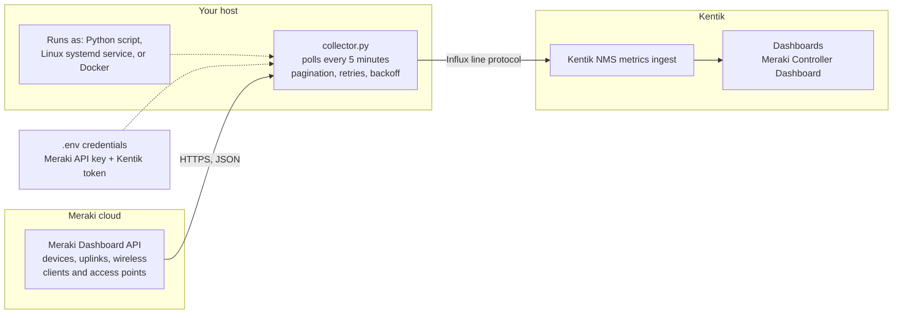

# Meraki-to-Kentik metrics collector

This package collects Meraki Dashboard API telemetry and emits Influx line protocol for Kentik. The archive does **not** include `.env` or credentials.

## How it works



1. The collector calls the Meraki Dashboard API with your API key and follows `Link` header pagination.
2. It converts the results into Influx line protocol: device status, uplinks, wireless connection stats, access points, and wireless clients.
3. It posts the metrics to the Kentik ingest URL, retrying temporary failures and honoring Meraki `Retry-After` limits.
4. Kentik stores the metrics, and you build dashboard tables from them (see the screenshot and the troubleshooting steps at the bottom of this page).

Use `--dry-run` to print the metrics without sending them to Kentik.

## Download for Linux

[**Download meraki-kentik-poc.tar.gz**](https://github.com/NeoMatrix1217/Meraki-Kentik/raw/HEAD/downloads/meraki-kentik-poc.tar.gz) contains the collector, the systemd installer and service file, `.env.example`, the Dockerfile, tests, and documentation. It never contains credentials.

Install it on a Linux server (Python 3.9+ and systemd) from a terminal:

```bash
curl -L -o meraki-kentik-poc.tar.gz https://github.com/NeoMatrix1217/Meraki-Kentik/raw/HEAD/downloads/meraki-kentik-poc.tar.gz
tar -xzf meraki-kentik-poc.tar.gz
cd meraki-kentik-poc
sudo ./install-systemd.sh
sudoedit /etc/meraki-kentik/meraki-kentik.env
sudo systemctl start meraki-kentik.service
sudo journalctl -u meraki-kentik.service -f
```

If the `curl` command fails (for example, the repository is private), download the file in your browser from the link above and copy it to the server. See [Install as a Linux systemd agent](#install-as-a-linux-systemd-agent) for details.

## First install

```bash
cd ~/Downloads
tar -xzf meraki-kentik-poc.tar.gz
cd meraki-kentik-poc
cp .env.example .env
chmod 600 .env
nano .env
python3 collector.py --mode mock --dry-run
python3 collector.py --mode real --dry-run
```

## Install the Python script directly

The collector uses only the Python standard library; Python 3.9 or newer is sufficient. From the directory containing the archive:

```bash
cd ~/Downloads
tar -xzf meraki-kentik-poc.tar.gz
cd meraki-kentik-poc
cp .env.example .env
chmod 600 .env
nano .env
python3 collector.py --mode mock --dry-run
python3 collector.py --mode real --dry-run
python3 collector.py --mode real
```

Use `--mode real --interval 300` for continuous five-minute collection. The real dry-run queries Meraki but does not send to Kentik. Set `MERAKI_CLIENT_TIMESPAN=86400` in `.env` to keep the default 24-hour client lookback.

## Upgrade while preserving credentials

Run this from the directory containing both the existing folder and the new archive. The `if` guard avoids the silent failure that can otherwise leave the new install without `.env`.

```bash
set -eu
cd ~/Downloads
if [ -f meraki-kentik-poc/.env ]; then
  cp meraki-kentik-poc/.env /tmp/meraki-kentik-poc.env
else
  echo "No existing .env found; create one from .env.example after extraction."
  rm -f /tmp/meraki-kentik-poc.env
fi
rm -rf meraki-kentik-poc
tar -xzf meraki-kentik-poc.tar.gz
if [ -f /tmp/meraki-kentik-poc.env ]; then
  mv /tmp/meraki-kentik-poc.env meraki-kentik-poc/.env
  chmod 600 meraki-kentik-poc/.env
else
  cp meraki-kentik-poc/.env.example meraki-kentik-poc/.env
  chmod 600 meraki-kentik-poc/.env
fi
cd meraki-kentik-poc
python3 collector.py --mode mock --dry-run
python3 collector.py --mode real --dry-run
```

`--mode real --dry-run` reads Meraki credentials and queries Meraki, but does not send anything to Kentik.

The wireless client lookback defaults to 24 hours through `MERAKI_CLIENT_TIMESPAN=86400`; adjust it in `.env` if a shorter or longer view is needed. Client rows include `last_connected` as a **dimension** (text), such as `10/14/2026 12:00 PM UTC`, so Kentik tables can show it as a readable column. It is rounded down to `LAST_CONNECTED_ROUND_SECONDS` (default 3600 = hourly; 86400 = daily; 0 = exact seconds) because every new value creates a new series in Kentik. The ISO-8601 `connected_at` field and the point timestamp are unchanged.

For larger organizations, the collector follows Meraki `Link` headers to retrieve additional pages. Transient Meraki and Kentik failures are retried with exponential backoff, and HTTP 429 responses honor `Retry-After`. Tune `HTTP_MAX_RETRIES`, `HTTP_RETRY_BACKOFF_SECONDS`, and `MERAKI_MAX_PAGES` in `.env` if needed.

## Measurements

The collector includes device, uplink, wireless-client, and `meraki_wireless_access_point` measurements. The AP measurement includes AP name/IP/MAC, BSSID, SSID, radio type, channel, endpoint count, bandwidth usage, and channel-utilization metrics.

## Install as a Linux systemd agent

The systemd package runs the collector continuously as the unprivileged `meraki-kentik` service user. It polls every five minutes, restarts on failure, sends logs to journald, and keeps credentials outside the application directory. The installer enables the service but does not start it until credentials are configured.

From the extracted package directory:

```bash
sudo ./install-systemd.sh
sudoedit /etc/meraki-kentik/meraki-kentik.env
sudo systemctl start meraki-kentik.service
sudo systemctl status meraki-kentik.service
sudo journalctl -u meraki-kentik.service -f
```

The installer preserves an existing `/etc/meraki-kentik/meraki-kentik.env`. The service unit is installed at `/etc/systemd/system/meraki-kentik.service`, and the collector is installed at `/opt/meraki-kentik/collector.py`.

The archive does not contain credentials. Configure `MERAKI_API_KEY`, `MERAKI_ORG_ID`, `KENTIK_INGEST_URL`, `KENTIK_EMAIL`, and `KENTIK_API_TOKEN` in the environment file before relying on the service.

## More documentation

- [Troubleshooting](#troubleshooting) (bottom of this page)
- [Building the Kentik dashboard](docs/KENTIK_DASHBOARD.md)
- [Running with Docker](docs/DOCKER.md)
- [Changelog](CHANGELOG.md)

## Kentik dashboard example

Example Kentik "Meraki Controller Dashboard" built from the collector's `meraki_wireless_client`, `meraki_wireless_access_point`, `meraki_wireless_connection`, and `meraki_device_status` measurements.


## Troubleshooting

Quick triage, in order:

1. **Collector reaches Meraki?** Run `python3 collector.py --mode real --dry-run`. Metric lines mean Meraki credentials work.
2. **Collector sends to Kentik?** Run `python3 collector.py --mode real`. An HTTP error means a Kentik URL, email, or token problem.
3. **Data visible in Kentik?** Wait a few minutes, then add the dimensions and metrics to your dashboard panel.

### `can't open file '.../collector.py': No such file or directory`
You are running the command from the wrong folder. `cd` into the project folder first and confirm with `ls -a`:

```bash
cd ~/Downloads/Meraki-Kentik
ls -a        # should list collector.py and .env
python3 collector.py --mode real --dry-run
```

### `zsh: bad pattern: [200~...` after pasting a command
Terminal bracketed paste added a hidden marker. Run `unset zle_bracketed_paste`, or type the command instead of pasting it.

### `zsh: command not found: rg`
`rg` (ripgrep) is optional. Use macOS `grep` instead, for example `python3 collector.py --mode mock --dry-run | grep last_connected`.

### `MERAKI_API_KEY and MERAKI_ORG_ID are required`
The `.env` file is missing or in a different folder. Create it with `cp .env.example .env`, `chmod 600 .env`, then edit it. The release packages never include `.env`.

### `unrecognized arguments: python3 collector.py`
Two commands were pasted on one line. Run only one command at a time.

### HTTP 401 / 403 from Meraki
The API key is invalid, revoked, or lacks access to the organization. Generate a new key in the Meraki Dashboard and update `MERAKI_API_KEY`.

### HTTP 429 or repeated retries
Meraki is rate limiting. The collector honors `Retry-After` and retries with backoff. Increase `--interval`, lower `MAX_WIRELESS_CLIENTS`, or raise `HTTP_RETRY_BACKOFF_SECONDS`.

### Kentik ingest returns an HTTP error
Check `KENTIK_INGEST_URL` (including the `bucket` and `org` values), `KENTIK_EMAIL`, and `KENTIK_API_TOKEN`. Test with `--dry-run` first to separate Meraki problems from Kentik problems.

### Dry-run shows 0 `meraki_wireless_client` lines
Meraki returned no wireless clients inside the lookback window. Increase `MERAKI_CLIENT_TIMESPAN` (for example `604800` for 7 days).

### `last_connected` is not visible in Kentik
`last_connected` is a **dimension**. A saved Kentik panel only shows the dimensions it was built with, so add it by hand:
1. Confirm the collector emits it: `python3 collector.py --mode real --dry-run | grep -o 'last_connected=[^,]*' | head -3`
2. Send data: `python3 collector.py --mode real`
3. Wait a few minutes, then edit the panel and add `last_connected` in the **Dimensions** pane.

`last_connected=unknown` means Meraki did not return a usable `lastSeen` for that client.

### "Last connected" shows `0.00` or `1.00`
That is the numeric `connected` metric (true/false). Use the `last_connected` dimension for a readable date.

### Too many rows or stale rows in the client table
Each distinct `last_connected` value is a separate series. Raise `LAST_CONNECTED_ROUND_SECONDS` (`3600` hourly, `86400` daily) to reduce churn.
