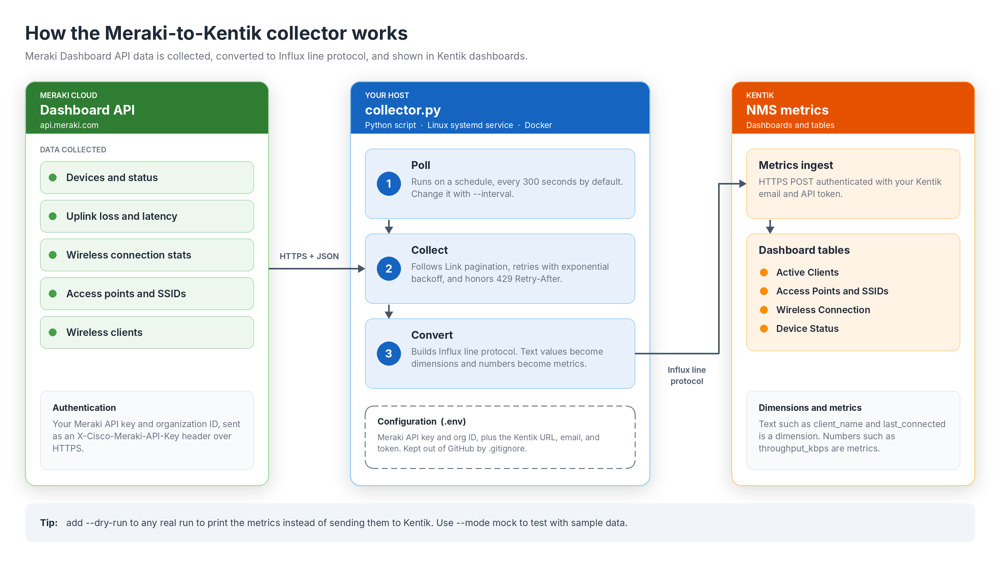
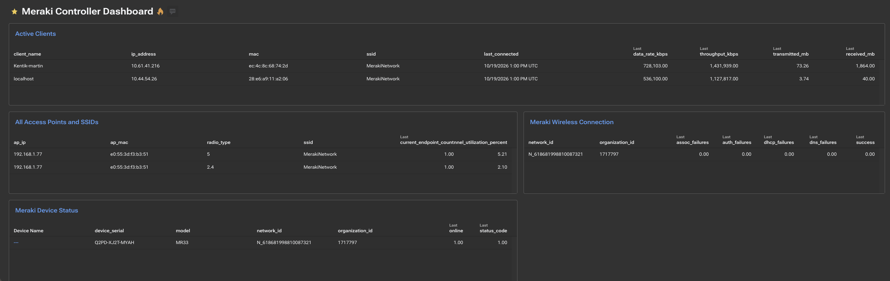

# Meraki-to-Kentik metrics collector

Collects Cisco Meraki Dashboard API telemetry and sends it to Kentik NMS as Influx line protocol. It uses only the Python standard library (Python 3.9 or newer). This repository and its packages **never include `.env` or credentials**.

**Contents:** [How it works](#how-it-works) · [Quick start for Linux](#quick-start-for-linux) · [What you get in Kentik](#what-you-get-in-kentik) · [Install options](#install-options) · [Configuration](#configuration) · [Tests](#tests) · [Changelog](#changelog) · [Dashboard example](#kentik-dashboard-example) · [Troubleshooting](#troubleshooting)

## How it works



1. **Poll.** The collector runs on a schedule (every 300 seconds by default) and calls the Meraki Dashboard API with your API key.
2. **Collect.** It follows `Link` header pagination, retries temporary failures with exponential backoff, and honors Meraki `Retry-After` limits on HTTP 429.
3. **Convert.** It turns the results into Influx line protocol. Text values such as client name, SSID, and `last_connected` become dimensions; numbers such as throughput and signal strength become metrics.
4. **Send.** It posts the metrics to your Kentik ingest URL, where you build dashboard tables from them.

Add `--dry-run` to any real run to print the metrics without sending them to Kentik.

## Quick start for Linux

[**Download meraki-kentik-poc.tar.gz**](https://github.com/NeoMatrix1217/Meraki-Kentik/raw/HEAD/downloads/meraki-kentik-poc.tar.gz) contains the collector, the systemd installer and service file, `.env.example`, the Dockerfile, tests, and the dashboard screenshot.

On a Linux server with Python 3.9+ and systemd:

```bash
curl -L -o meraki-kentik-poc.tar.gz https://github.com/NeoMatrix1217/Meraki-Kentik/raw/HEAD/downloads/meraki-kentik-poc.tar.gz
tar -xzf meraki-kentik-poc.tar.gz
cd meraki-kentik-poc
sudo ./install-systemd.sh
sudoedit /etc/meraki-kentik/meraki-kentik.env
sudo systemctl start meraki-kentik.service
sudo journalctl -u meraki-kentik.service -f
```

If `curl` fails (for example, the repository is private), download the file in your browser from the link above and copy it to the server.

## What you get in Kentik

The collector writes these measurements to Kentik. Create one table panel per measurement.

| Panel | Measurement | Dimensions to add | Metrics to add |
|---|---|---|---|
| Active Clients | `meraki_wireless_client` | `client_name`, `ip_address`, `mac`, `ssid`, `last_connected` | `data_rate_kbps`, `throughput_kbps`, `transmitted_mb`, `received_mb` |
| All Access Points and SSIDs | `meraki_wireless_access_point` | `ap_ip`, `ap_mac`, `radio_type`, `ssid` | `current_endpoint_count`, `channel_utilization_percent` |
| Meraki Wireless Connection | `meraki_wireless_connection` | `network_id`, `organization_id` | `assoc_failures`, `auth_failures`, `dhcp_failures`, `dns_failures`, `success` |
| Meraki Device Status | `meraki_device_status` | `device_name`, `device_serial`, `model`, `network_id`, `organization_id` | `online`, `status_code` |

The AP measurement includes AP name, IP, and MAC, BSSID, SSID, radio type, channel, endpoint count, bandwidth usage, and channel-utilization values.

### Build the panels

1. Run the collector so data exists: `python3 collector.py --mode real`.
2. In Kentik, create or open a dashboard and add a panel for the Kentik NMS metrics source.
3. Select the measurement from the table above.
4. In the **Dimensions** pane, add the listed dimensions. Dimensions are the text columns.
5. Add the listed metrics. Metrics are the numeric columns.
6. Choose a table visualization, set a time range of at least the last hour, and save.

### Notes

- `last_connected` is a dimension, not a metric, so it appears as a readable text column. It is rounded by `LAST_CONNECTED_ROUND_SECONDS` (default 3600).
- The numeric `connected` metric is true/false and is not a date.
- Menu names can differ between Kentik portal versions; use the pane names above as a guide.

## Install options

### Option A: Python script (macOS or Linux)

```bash
cd ~/Downloads
tar -xzf meraki-kentik-poc.tar.gz
cd meraki-kentik-poc
cp .env.example .env
chmod 600 .env
nano .env
python3 collector.py --mode mock --dry-run       # no network, sample data
python3 collector.py --mode real --dry-run       # queries Meraki, does not send to Kentik
python3 collector.py --mode real                 # one collection, sent to Kentik
python3 collector.py --mode real --interval 300  # continuous, every 5 minutes (Ctrl+C to stop)
```

Run these from inside the project folder, one command at a time.

### Upgrade without losing credentials

Run this from the directory containing both the existing folder and the new archive. The `if` guard avoids the silent failure that can otherwise leave the new install without `.env`.

```bash
set -eu
cd ~/Downloads
if [ -f meraki-kentik-poc/.env ]; then
  cp meraki-kentik-poc/.env /tmp/meraki-kentik-poc.env
else
  echo "No existing .env found; create one from .env.example after extraction."
  rm -f /tmp/meraki-kentik-poc.env
fi
rm -rf meraki-kentik-poc
tar -xzf meraki-kentik-poc.tar.gz
if [ -f /tmp/meraki-kentik-poc.env ]; then
  mv /tmp/meraki-kentik-poc.env meraki-kentik-poc/.env
  chmod 600 meraki-kentik-poc/.env
else
  cp meraki-kentik-poc/.env.example meraki-kentik-poc/.env
  chmod 600 meraki-kentik-poc/.env
fi
cd meraki-kentik-poc
python3 collector.py --mode mock --dry-run
python3 collector.py --mode real --dry-run
```

`--mode real --dry-run` reads Meraki credentials and queries Meraki, but does not send anything to Kentik.

### Option B: Linux systemd agent

Runs the collector continuously as the unprivileged `meraki-kentik` service user. It polls every five minutes, restarts on failure, logs to journald, and keeps credentials outside the application directory. The installer enables the service but does not start it until credentials are configured.

From the extracted package directory:

```bash
sudo ./install-systemd.sh
sudoedit /etc/meraki-kentik/meraki-kentik.env
sudo systemctl start meraki-kentik.service
sudo systemctl status meraki-kentik.service
sudo journalctl -u meraki-kentik.service -f
```

The installer preserves an existing `/etc/meraki-kentik/meraki-kentik.env`. The unit is installed at `/etc/systemd/system/meraki-kentik.service` and the collector at `/opt/meraki-kentik/collector.py`. To stop it, run `sudo systemctl stop meraki-kentik.service`. To upgrade, run `sudo ./install-systemd.sh` again, then `sudo systemctl restart meraki-kentik.service`.

### Option C: Docker

The collector has no third-party Python dependencies. Credentials stay in a local `.env` file and are never baked into the image.

```bash
cp .env.example .env
chmod 600 .env
nano .env

docker build -t meraki-kentik .
docker run --rm --env-file .env meraki-kentik python collector.py --mode real --dry-run
docker run -d --restart unless-stopped --name meraki-kentik --env-file .env meraki-kentik
```

Useful commands:

```bash
docker logs -f meraki-kentik     # follow collection output
docker stop meraki-kentik        # stop
docker rm meraki-kentik          # remove before re-running with a new image
```

The default container command collects every 300 seconds. Docker's `--env-file` expects plain `KEY=VALUE` lines without quotes.

## Configuration

Copy `.env.example` to `.env`, or edit `/etc/meraki-kentik/meraki-kentik.env` for the systemd service.

| Setting | Default | Purpose |
|---|---|---|
| `MERAKI_API_KEY` | none | Meraki Dashboard API key (required for real mode) |
| `MERAKI_ORG_ID` | none | Meraki organization ID (required for real mode) |
| `KENTIK_INGEST_URL` | Kentik metrics write URL | Must include your `bucket` and `org` values |
| `KENTIK_EMAIL` | none | Kentik account email |
| `KENTIK_API_TOKEN` | none | Kentik API token |
| `MERAKI_BASE_URL` | `https://api.meraki.com/api/v1` | Meraki API base URL |
| `HTTP_TIMEOUT_SECONDS` | `20` | Per-request timeout |
| `HTTP_MAX_RETRIES` | `3` | Retries for transient Meraki and Kentik errors |
| `HTTP_RETRY_BACKOFF_SECONDS` | `1.0` | Starting backoff, doubled each retry; `Retry-After` is honored |
| `MERAKI_MAX_PAGES` | `100` | Maximum `Link` header pages followed per request |
| `MERAKI_CLIENT_TIMESPAN` | `86400` | Client lookback in seconds (24 hours) |
| `MAX_WIRELESS_CLIENTS` | `100` | Cap on clients that get signal and data-rate lookups |
| `MAX_WIRELESS_ACCESS_POINTS` | `100` | Cap on access points that get history lookups |
| `LAST_CONNECTED_ROUND_SECONDS` | `3600` | Rounding for `last_connected`: `3600` hourly, `86400` daily, `0` exact seconds |

## Tests

```bash
python3 -m unittest -q
```

## Changelog

**Unreleased**

- Add `last_connected`, a readable UTC date/time dimension on `meraki_wireless_client`, rounded by `LAST_CONNECTED_ROUND_SECONDS` (default 3600).
- Accept `lastSeen` as an epoch number, numeric string, millisecond epoch, or ISO-8601 date; emit `last_connected=unknown` when unavailable.
- Keep `connected_at` (ISO-8601) as a field and `lastSeen` as the point timestamp.
- Follow Meraki `Link` header pagination, bounded by `MERAKI_MAX_PAGES`.
- Retry transient Meraki and Kentik failures with exponential backoff; honor `Retry-After` on HTTP 429.
- Add a "How it works" diagram, a Linux download link, and troubleshooting, Kentik dashboard, and Docker documentation to this README.

## Kentik dashboard example

Example Kentik "Meraki Controller Dashboard" built from the `meraki_wireless_client`, `meraki_wireless_access_point`, `meraki_wireless_connection`, and `meraki_device_status` measurements.



## Troubleshooting

Quick triage, in order:

1. **Collector reaches Meraki?** Run `python3 collector.py --mode real --dry-run`. Metric lines mean the Meraki credentials work.
2. **Collector sends to Kentik?** Run `python3 collector.py --mode real`. An HTTP error means a Kentik URL, email, or token problem.
3. **Data visible in Kentik?** Wait a few minutes, then add the dimensions and metrics to your dashboard panel.

### `can't open file '.../collector.py': No such file or directory`
You are running the command from the wrong folder. `cd` into the project folder first and confirm with `ls -a`:

```bash
cd ~/Downloads/Meraki-Kentik
ls -a        # should list collector.py and .env
python3 collector.py --mode real --dry-run
```

### `zsh: bad pattern: [200~...` after pasting a command
Terminal bracketed paste added a hidden marker. Run `unset zle_bracketed_paste`, or type the command instead of pasting it.

### `zsh: command not found: rg`
`rg` (ripgrep) is optional. Use macOS `grep` instead, for example `python3 collector.py --mode mock --dry-run | grep last_connected`.

### `MERAKI_API_KEY and MERAKI_ORG_ID are required`
The `.env` file is missing or in a different folder. Create it with `cp .env.example .env`, `chmod 600 .env`, then edit it. The release packages never include `.env`.

### `unrecognized arguments: python3 collector.py`
Two commands were pasted on one line. Run only one command at a time.

### HTTP 401 / 403 from Meraki
The API key is invalid, revoked, or lacks access to the organization. Generate a new key in the Meraki Dashboard and update `MERAKI_API_KEY`.

### HTTP 429 or repeated retries
Meraki is rate limiting. The collector honors `Retry-After` and retries with backoff. Increase `--interval`, lower `MAX_WIRELESS_CLIENTS`, or raise `HTTP_RETRY_BACKOFF_SECONDS`.

### Kentik ingest returns an HTTP error
Check `KENTIK_INGEST_URL` (including the `bucket` and `org` values), `KENTIK_EMAIL`, and `KENTIK_API_TOKEN`. Test with `--dry-run` first to separate Meraki problems from Kentik problems.

### Dry-run shows 0 `meraki_wireless_client` lines
Meraki returned no wireless clients inside the lookback window. Increase `MERAKI_CLIENT_TIMESPAN` (for example `604800` for 7 days).

### `last_connected` is not visible in Kentik
`last_connected` is a **dimension**. A saved Kentik panel only shows the dimensions it was built with, so add it by hand:
1. Confirm the collector emits it: `python3 collector.py --mode real --dry-run | grep -o 'last_connected=[^,]*' | head -3`
2. Send data: `python3 collector.py --mode real`
3. Wait a few minutes, then edit the panel and add `last_connected` in the **Dimensions** pane.

`last_connected=unknown` means Meraki did not return a usable `lastSeen` for that client.

### "Last connected" shows `0.00` or `1.00`
That is the numeric `connected` metric (true/false). Use the `last_connected` dimension for a readable date.

### Too many rows or stale rows in the client table
Each distinct `last_connected` value is a separate series. Raise `LAST_CONNECTED_ROUND_SECONDS` (`3600` hourly, `86400` daily) to reduce churn.

