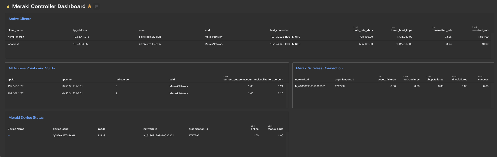

# Meraki-to-Kentik metrics collector

This package collects Meraki Dashboard API telemetry and emits Influx line protocol for Kentik. The archive does **not** include `.env` or credentials.

## First install

```bash
cd ~/Downloads
tar -xzf meraki-kentik-poc.tar.gz
cd meraki-kentik-poc
cp .env.example .env
chmod 600 .env
nano .env
python3 collector.py --mode mock --dry-run
python3 collector.py --mode real --dry-run
```

## Install the Python script directly

The collector uses only the Python standard library; Python 3.9 or newer is sufficient. From the directory containing the archive:

```bash
cd ~/Downloads
tar -xzf meraki-kentik-poc.tar.gz
cd meraki-kentik-poc
cp .env.example .env
chmod 600 .env
nano .env
python3 collector.py --mode mock --dry-run
python3 collector.py --mode real --dry-run
python3 collector.py --mode real
```

Use `--mode real --interval 300` for continuous five-minute collection. The real dry-run queries Meraki but does not send to Kentik. Set `MERAKI_CLIENT_TIMESPAN=86400` in `.env` to keep the default 24-hour client lookback.

## Upgrade while preserving credentials

Run this from the directory containing both the existing folder and the new archive. The `if` guard avoids the silent failure that can otherwise leave the new install without `.env`.

```bash
set -eu
cd ~/Downloads
if [ -f meraki-kentik-poc/.env ]; then
  cp meraki-kentik-poc/.env /tmp/meraki-kentik-poc.env
else
  echo "No existing .env found; create one from .env.example after extraction."
  rm -f /tmp/meraki-kentik-poc.env
fi
rm -rf meraki-kentik-poc
tar -xzf meraki-kentik-poc.tar.gz
if [ -f /tmp/meraki-kentik-poc.env ]; then
  mv /tmp/meraki-kentik-poc.env meraki-kentik-poc/.env
  chmod 600 meraki-kentik-poc/.env
else
  cp meraki-kentik-poc/.env.example meraki-kentik-poc/.env
  chmod 600 meraki-kentik-poc/.env
fi
cd meraki-kentik-poc
python3 collector.py --mode mock --dry-run
python3 collector.py --mode real --dry-run
```

`--mode real --dry-run` reads Meraki credentials and queries Meraki, but does not send anything to Kentik.

The wireless client lookback defaults to 24 hours through `MERAKI_CLIENT_TIMESPAN=86400`; adjust it in `.env` if a shorter or longer view is needed. Client rows include `last_connected` as a **dimension** (text), such as `10/14/2026 12:00 PM UTC`, so Kentik tables can show it as a readable column. It is rounded down to `LAST_CONNECTED_ROUND_SECONDS` (default 3600 = hourly; 86400 = daily; 0 = exact seconds) because every new value creates a new series in Kentik. The ISO-8601 `connected_at` field and the point timestamp are unchanged.

For larger organizations, the collector follows Meraki `Link` headers to retrieve additional pages. Transient Meraki and Kentik failures are retried with exponential backoff, and HTTP 429 responses honor `Retry-After`. Tune `HTTP_MAX_RETRIES`, `HTTP_RETRY_BACKOFF_SECONDS`, and `MERAKI_MAX_PAGES` in `.env` if needed.

## Measurements

The collector includes device, uplink, wireless-client, and `meraki_wireless_access_point` measurements. The AP measurement includes AP name/IP/MAC, BSSID, SSID, radio type, channel, endpoint count, bandwidth usage, and channel-utilization metrics.

## Install as a Linux systemd agent

The systemd package runs the collector continuously as the unprivileged `meraki-kentik` service user. It polls every five minutes, restarts on failure, sends logs to journald, and keeps credentials outside the application directory. The installer enables the service but does not start it until credentials are configured.

From the extracted package directory:

```bash
sudo ./install-systemd.sh
sudoedit /etc/meraki-kentik/meraki-kentik.env
sudo systemctl start meraki-kentik.service
sudo systemctl status meraki-kentik.service
sudo journalctl -u meraki-kentik.service -f
```

The installer preserves an existing `/etc/meraki-kentik/meraki-kentik.env`. The service unit is installed at `/etc/systemd/system/meraki-kentik.service`, and the collector is installed at `/opt/meraki-kentik/collector.py`.

The archive does not contain credentials. Configure `MERAKI_API_KEY`, `MERAKI_ORG_ID`, `KENTIK_INGEST_URL`, `KENTIK_EMAIL`, and `KENTIK_API_TOKEN` in the environment file before relying on the service.

## Kentik dashboard example

Example Kentik "Meraki Controller Dashboard" built from the collector's `meraki_wireless_client`, `meraki_wireless_access_point`, `meraki_wireless_connection`, and `meraki_device_status` measurements.


